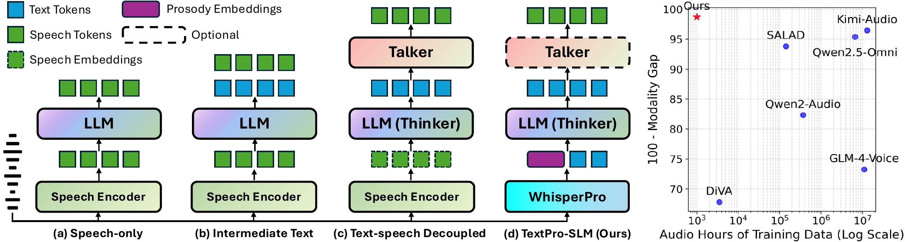
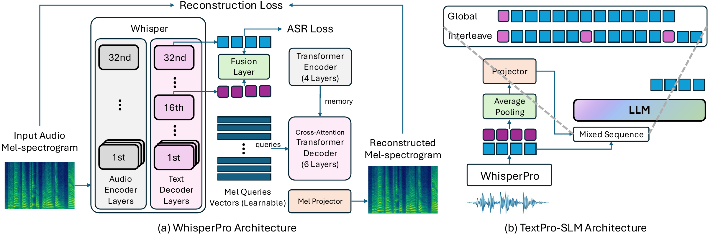

<div align="center">

# TextPro-SLM
### Your Speech LLM Can Be a Prosody-Aware Text LLM

**Minimizing Modality Gap from the Input Side**

[](https://arxiv.org/abs/2605.05927)
[](https://huggingface.co/qqjz/WhisperPro)
[](https://huggingface.co/qqjz/TextPro-SLM-7B-Global)

[Quick start](#quick-start) · [Released models](#released-models) · [Citation](#citation)

</div>

## News

- 🎉 Our paper has been accepted to **NeurIPS 2026**!

TextPro-SLM makes spoken input closer to what a text LLM already understands. **WhisperPro** produces a transcript and synchronized prosody features. The LLM receives the transcript as ordinary text tokens, alongside compact embeddings that retain information about how the words were spoken.

**Strong semantics, richer prosody, limited adaptation data.** The paper reports the lowest average semantic modality gap among the compared SLMs at both 3B and 7B scales, with competitive paralinguistic understanding. LLM adaptation uses roughly **1,000 hours of audio**; this figure excludes pretraining of the underlying Whisper and Qwen backbones.



*Figure 1. Architectural comparison with prior speech LLMs (left), and modality gap versus audio training data (right).*

This release provides **six checkpoints and inference code**. Model weights are hosted on Hugging Face. Training code, training data, and evaluation datasets are outside this release.



*Figure 2. WhisperPro architecture (left) and TextPro-SLM architecture with global prepending or interleaving (right).*

## Released models

| Speech LLM | Fusion | Paired encoder | Audio input | License |
| --- | --- | --- | --- | --- |
| [TextPro-SLM-7B-Global](https://huggingface.co/qqjz/TextPro-SLM-7B-Global) | Global prepending | [WhisperPro](https://huggingface.co/qqjz/WhisperPro) | ≤30s | Apache-2.0 |
| [TextPro-SLM-7B-Interleaving](https://huggingface.co/qqjz/TextPro-SLM-7B-Interleaving) | 5:1 text–prosody interleaving | [WhisperPro](https://huggingface.co/qqjz/WhisperPro) | ≤30s | Apache-2.0 |
| [TextPro-SLM-3B-Global](https://huggingface.co/qqjz/TextPro-SLM-3B-Global) | Global prepending | [WhisperPro](https://huggingface.co/qqjz/WhisperPro) | ≤30s | Qwen Research |
| [TextPro-SLM-7B-30Plus](https://huggingface.co/qqjz/TextPro-SLM-7B-30Plus) | Global prepending | [WhisperPro-30Plus](https://huggingface.co/qqjz/WhisperPro-30Plus) | Segmented long audio | Apache-2.0 |

Start with **7B Global** for the paper's main setting, **3B Global** for a smaller LLM, or the paired **30Plus** models for speech longer than 30 seconds. The original and 30Plus encoders are separate checkpoints and should be used with their paired LLMs. The 30Plus extension was trained separately after the paper experiments; the paper results below concern the original models.

## Results from the paper

| Model | Semantic average accuracy (%) ↑ | Average modality gap (%) ↓ |
| --- | ---: | ---: |
| TextPro-SLM-3B Global | 74.3 | 2.6 |
| TextPro-SLM-7B Global | **82.5** | **0.7** |
| TextPro-SLM-7B Interleaving | 82.1 | 1.1 |

These averages cover SC, MMSU, OBQA, ARC-E, ARC-C, and PIQA in the paper's main semantic table. The gap is the accuracy difference from the corresponding text backbone; values follow the paper's percentage notation. On paralinguistic tasks, TextPro-SLM-7B obtains **64.8% average accuracy** across emotion, gender, age, and accent classification. The first three tasks come from AIR-Bench; accent uses our separately constructed AIR-Bench-style benchmark. See the paper for evaluation protocols and comparisons. These are reported paper results, rather than benchmark reruns performed for this code release.

## Quick start

Use Python 3.10 or newer. Install a CUDA-compatible PyTorch build first, following the [official PyTorch instructions](https://pytorch.org/get-started/locally/), then install this repository:

```bash
git clone https://github.com/dreamtheater123/TextPro-SLM.git
cd TextPro-SLM
python -m pip install --upgrade pip
python -m pip install -e .
```

For 30Plus, install the extra VAD and matching torchaudio dependencies:

```bash
python -m pip install -e '.[long-audio]'
```

The code uses Transformers **4.49.0** to preserve the original inference behavior. CUDA inference uses FP32 WhisperPro and a BF16 LLM/projector. A GPU with around 24 GB or more is a practical starting point for 7B; actual peak memory depends on input and response length. CPU mode uses FP32 throughout and is substantially slower.

### Decoding settings

The paper uses **sampling with temperature 0.7 and top-p 0.9**, with a **512-token maximum response length**. The examples below explicitly use these settings. The supplied checkpoint also retains its original `top_k=20` and `repetition_penalty=1.05` settings.

**Greedy decoding is supported as an option:** add `--greedy` to a command, or use `do_sample=False` in Python. Greedy disables sampling; temperature and top-p do not apply in that mode.

### Mode 1: Audio only — spoken instructions and QA

The recording contains the complete question or instruction. WhisperPro transcribes it, and the LLM answers it. This is the input mode used for VoiceBench and general spoken QA; **no separate text instruction is needed**.

```bash
textpro-slm \
  --model qqjz/TextPro-SLM-7B-Global \
  --audio /path/to/spoken_question.wav \
  --task semantic \
  --max-new-tokens 512 \
  --temperature 0.7 \
  --top-p 0.9
```

For a semantic multiple-choice question, we recommend the **VoiceBench format** below. Record or synthesize the **whole question, options, and final instruction** as the audio input:

```text
[Question]
A. [Option A]
B. [Option B]
C. [Option C]
D. [Option D]
What is the answer to the above multiple choice question? Select one of the following: A, B, C, or D.
```

This final instruction matches the `prompt` fields in VoiceBench's OpenBookQA and MMSU data. `[Question]` and the option placeholders should be replaced with your question and choices. In this mode, the instruction is spoken in the recording, rather than passed through `--instruction`.

### Mode 2: Audio + text instruction — AIR-Bench-style QA

The audio is the speech to analyze. A separate **text instruction** supplies the question and answer choices. The model receives the ASR transcript, prosody, and this text instruction, as in the paper's AIR-Bench inference.

For example, the following is a real question and choice set from the evaluated **AIR-Bench emotion-recognition task** (Foundation metadata, IEMOCAP, `uniq_id=3973`):

```text
Choose the most suitable answer from options A, B, C, and D to respond the question in next line, you may only choose A or B or C or D.
What emotion is at the forefront of the speaker's words?
A. angry
B. sad
C. happy
D. neutral
```

The prompt is saved in [`examples/airbench_emotion_instruction.txt`](examples/airbench_emotion_instruction.txt). Run it with your speech recording:

```bash
textpro-slm \
  --model qqjz/TextPro-SLM-7B-Global \
  --audio /path/to/emotion_speech.wav \
  --task emotion \
  --instruction "$(cat examples/airbench_emotion_instruction.txt)" \
  --max-new-tokens 512 \
  --temperature 0.7 \
  --top-p 0.9
```

`--task emotion` selects the original emotion system prompt. For the paper's gender, age, and accent tasks, use `--task audio` with the corresponding question and choices. The `--task` option selects the system prompt; `--instruction` supplies the actual text question. The model generates an answer normally, with the instruction requesting A/B/C/D. This example does not bundle benchmark audio or ground-truth answers.

### Audio duration: original models and 30Plus

**The original models require the complete audio input to be at most 30 seconds**, including any spoken question, options, and instruction. For audio longer than 30 seconds, use **TextPro-SLM-7B-30Plus with WhisperPro-30Plus**. The matching encoder is selected automatically:

```bash
textpro-slm \
  --model qqjz/TextPro-SLM-7B-30Plus \
  --audio /path/to/long_spoken_question.wav \
  --task semantic \
  --max-new-tokens 512 \
  --temperature 0.7 \
  --top-p 0.9
```

30Plus supports the same two input modes: omit `--instruction` for spoken QA, or supply it for audio + text QA. It segments speech into chunks of at most 30 seconds, conditions later ASR segments on up to 224 preceding transcript tokens, and averages the segment prosody vectors equally. The LLM still has a finite context window, so input duration is not unlimited.

### Python API

```python
from pathlib import Path
from textpro_slm import TextProSLM

model = TextProSLM("qqjz/TextPro-SLM-7B-Global")

# Mode 1: the question and instruction are spoken in the audio.
spoken_qa = model.respond(
    audio="spoken_question.wav", task="semantic", max_new_tokens=512,
    do_sample=True, temperature=0.7, top_p=0.9,
)
print(spoken_qa["response"])

# Mode 2: analyze speech with a separate text question and choices.
instruction = Path("examples/airbench_emotion_instruction.txt").read_text().strip()
audio_qa = model.respond(
    audio="emotion_speech.wav", instruction=instruction, task="emotion",
    max_new_tokens=512, do_sample=True, temperature=0.7, top_p=0.9,
)
print(audio_qa["response"])
```

Minimal, commented scripts for the two modes are in [`examples/audio_only.py`](examples/audio_only.py) and [`examples/audio_text.py`](examples/audio_text.py). For local checkpoints, pass the paired directories:

```python
model = TextProSLM("/models/TextPro-SLM-7B-Global",
                   encoder="/models/WhisperPro")
```

Both components download automatically into the Hugging Face cache when Hub IDs are used. `--cache-dir` sets a custom cache location. `python -m textpro_slm` offers the same options as `textpro-slm`. CLI generation defaults to seed 42. Outputs are JSON containing `transcript`, `response`, `duration`, and `num_segments`.

### WhisperPro on its own

```bash
whisperpro \
  --model qqjz/WhisperPro \
  --audio /path/to/speech.wav \
  --prosody-output prosody.npy
```

Use `--token-level` to export the original encoder's sequence of 1280-dimensional decoder states. Select `qqjz/WhisperPro-30Plus` for long audio and its global prosody vector.

## Design and limitations

Global prepending injects one projected prosody vector at the beginning of the user content. Interleaving inserts a prosody marker before each group of five transcript tokens and pools the WhisperPro states into the corresponding groups. The supplied tokenizer and trained marker (`<|repo_name|>`, ID 151663) must be preserved. Loading `llm/` alone does not run the speech interface.

The models return text; speech synthesis is outside this release. ASR mistakes may affect answers, and generated responses can be incorrect. Most reported experiments concern English speech. Prosody pooling compresses temporal detail; results on unfamiliar languages, speaking styles, and recording conditions may vary. The package handles one audio file per request and resamples it to mono 16 kHz. Conversation history and streaming are outside the current API.

## Tests

```bash
python -m pip install -e '.[test]'
python -m pytest
```

Unit tests run without downloading checkpoints. GPU integration checks verified matching outputs against the original implementations for all four speech LLM variants.

## License and acknowledgments

**Built with Qwen.** Repository code is licensed under [Apache-2.0](LICENSE). The checkpoints retain their respective upstream terms: the 7B models and WhisperPro are Apache-2.0; **TextPro-SLM-3B-Global inherits the [Qwen Research License](https://huggingface.co/qqjz/TextPro-SLM-3B-Global/blob/main/LICENSE)** for non-commercial research/evaluation. Commercial use of that checkpoint requires separate permission from Alibaba Cloud. A code license does not replace a checkpoint's license.

We build on [OpenAI Whisper](https://github.com/openai/whisper), [Qwen2.5](https://github.com/QwenLM/Qwen2.5), [Transformers](https://github.com/huggingface/transformers), and [Silero VAD](https://github.com/snakers4/silero-vad). See [NOTICE](NOTICE).

## Citation

```bibtex
@inproceedings{cui2026textproslm,
  title={Minimizing Modality Gap from the Input Side: Your Speech LLM Can Be a Prosody-Aware Text LLM},
  author={Cui, Wenqian and Li, Xiao-Hui and Tan, Daxin and Zheng, Qiyong and King, Irwin},
  booktitle={Advances in Neural Information Processing Systems},
  year={2026},
}
```
